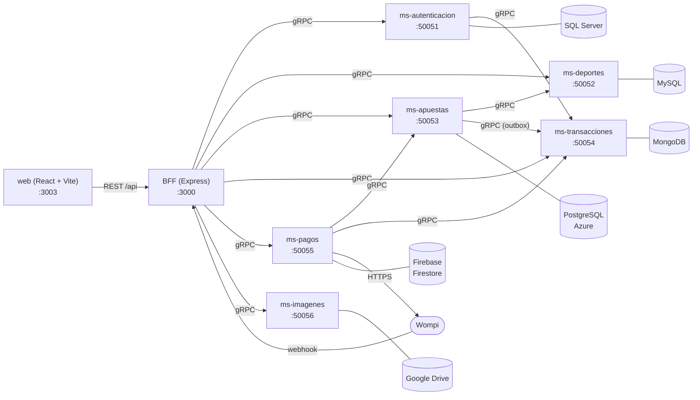

# GolDorado — microservicios

*Donde cada gol vale oro.* La casa de apuestas de fútbol del proyecto `goldorado`, ahora
separada en **seis microservicios que se comunican por gRPC**, un **BFF** que los integra y
ofrece **endpoints REST**, y el **mismo frontend React** (mismo diseño) consumiendo el BFF.
Incluye recargas de saldo con la pasarela **Wompi** (PSE y Web Checkout).

Tecnología: la misma del proyecto original — **Node.js + Express** en el backend y
**React 19 + Vite** en el frontend — más `@grpc/grpc-js` para la comunicación interna.

## Arquitectura



| Base (tablero de clase) | Microservicio | Qué guarda |
|---|---|---|
| **SQL Server** — loguin | `ms-autenticacion` | usuarios, contraseñas (bcrypt), roles, ficha del cliente, **tokens de seguridad** (tabla `Sesion`, revocables), cuentas de **Google y Microsoft**, recuperación de clave |
| **MySQL** — Jugadores | `ms-deportes` | jugadores, equipos y colores, estadios, torneos, temporadas, **calendario** (jornadas), encuentros, alineaciones, estadísticas |
| **PostgreSQL** — API (Azure) | `ms-apuestas` | el núcleo del negocio: mercados, cuotas, reglas, apuestas, **billetera**, promociones |
| **MongoDB** — transaccional y seguridad | `ms-transacciones` | libro de movimientos de dinero con su historial de estados, logs de inicio de sesión, eventos de seguridad |
| **Firebase** — PSE (Wompi) | `ms-pagos` | cada pago con Wompi y su historial de eventos |
| **Drive** — Imágenes | `ms-imagenes` | todas las imágenes (escudos, fotos de perfil, banners) |

Cada servicio es dueño de su base: nadie consulta la base de otro. Las referencias entre
bases son ids sin llave foránea, y la consistencia se sostiene con idempotencia, una bandeja
de salida (*outbox*) y conciliación — ver [docs/CONVENCIONES.md](docs/CONVENCIONES.md) §4.

## Estructura

```
goldorado-microservicios/
├── proto/                  contratos gRPC (.proto) compartidos
├── paquetes/comun/         @goldorado/comun: env, logs, errores, servidor/cliente gRPC, salud, pruebas
├── servicios/
│   ├── ms-autenticacion/   SQL Server   (db/01_esquema.sql, 02_datos.sql, 03_consultas.sql)
│   ├── ms-deportes/        MySQL        (db/01..03 .sql)
│   ├── ms-apuestas/        PostgreSQL   (db/01..03 .sql)
│   ├── ms-transacciones/   MongoDB      (db/01..03 .js para mongosh)
│   ├── ms-pagos/           Firestore + Wompi (db/ESTRUCTURA.md, reglas, índices, consultas)
│   └── ms-imagenes/        Google Drive (db/ESTRUCTURA.md, 03_consultas.md)
├── bff/                    Express: REST -> gRPC (+ scripts/verificar.js)
├── web/                    React 19 + Vite 7
├── docs/                   convenciones, contrato REST, consultas, Wompi, Google/Microsoft/Drive
└── docker-compose.yml      SQL Server, MySQL, PostgreSQL y MongoDB locales
```

## Documentación

| Documento | Contenido |
|---|---|
| [docs/CONSULTAS.md](docs/CONSULTAS.md) | **dónde están las consultas de cada base** y cómo correrlas |
| [docs/API-REST.md](docs/API-REST.md) | los endpoints REST del BFF |
| [docs/CONVENCIONES.md](docs/CONVENCIONES.md) | arquitectura, propiedad de los datos, ids semilla compartidos, variables de entorno |
| [docs/WOMPI.md](docs/WOMPI.md) | integración con Wompi (PSE por API, Web Checkout, webhooks, firmas, datos de prueba) |
| [docs/GOOGLE-MICROSOFT-DRIVE.md](docs/GOOGLE-MICROSOFT-DRIVE.md) | login con Google y Microsoft, y Google Drive para imágenes |
| `servicios/*/README.md`, `bff/README.md` | detalle de cada componente |

## Puesta en marcha

Requisitos: **Node.js 20.19+** (probado con 24). Las bases se pueden instalar localmente o
levantar con Docker (`docker compose up -d`, ver los puertos en `docker-compose.yml`).

```powershell
npm install                      # una sola vez, en la raíz (npm workspaces)

# 1. Configuración: en cada servicio, en bff/ copiar .env.example a .env y completarlo
#    (credenciales de cada base). Los valores por defecto ya traen los modos sin nube.

# 2. Crear y sembrar las bases (todas, o de a una con db:setup:auth, :deportes, ...)
npm run db:setup

# 3. Levantar todo: 6 microservicios + BFF + web
npm run dev                      # web en http://localhost:3003, BFF en :3000

# 4. Comprobar el sistema de punta a punta por REST
npm run verificar
```

### Modos sin nube (para desarrollar o hacer la demo)

| Servicio | Variable | Modo por defecto | Modo real |
|---|---|---|---|
| ms-pagos | `PAGOS_ALMACEN` | `memoria` | `firestore` (Firebase) |
| ms-pagos | `WOMPI_MODO` | `simulado` (banco que aprueba / que rechaza) | `sandbox` o `produccion` con llaves de Wompi |
| ms-imagenes | `IMAGENES_ALMACEN` | `local` (carpeta `storage/`) | `drive` (Google Drive) |
| ms-autenticacion | `GOOGLE_*`, `MICROSOFT_*` | vacíos: botones deshabilitados | con credenciales OAuth |

Los modos reales se configuran con las guías de `docs/`. SQL Server, MySQL, PostgreSQL y
MongoDB siempre son reales.

### Cuentas de prueba

| Correo | Contraseña | Rol |
|---|---|---|
| `demo@goldorado.co` (o documento `1012345678`) | `Demo1234!` | cliente, saldo $250.000 |
| `valentina.mesa@hotmail.com` | `Vale2024*` | cliente |
| `admin@goldorado.co` | `Admin2026#` | administrador |

En desarrollo el código de recuperación de contraseña es `482913`.

## Puertos

| Proceso | Puerto |
|---|---|
| web (Vite) | 3003 — reenvía `/api` al BFF |
| BFF | 3000 |
| ms-autenticacion … ms-imagenes | 50051 … 50056 (gRPC) |

## Pruebas y estado de la verificación

`npm test` corre las pruebas de todos los paquetes (sin bases de datos): **296 pruebas, 0 fallas**
(comun 15, autenticacion 47, deportes 50, apuestas 47, transacciones 41, pagos 34, imagenes 35,
BFF 27). Cada servicio incluye una prueba que lo arranca de verdad con su base inalcanzable.

Verificado además contra **motores reales**:

| Qué | Resultado |
|---|---|
| `db:setup` de ms-deportes en **MySQL 8.4.9** | 15 tablas, todas con ≥ 2 filas |
| `db:setup` de ms-apuestas en **PostgreSQL 18.3** | 10 tablas, 48 cuotas |
| `db:setup` de ms-transacciones en **MongoDB** | 3 colecciones con validadores e índices |
| `03_consultas.sql` de MySQL y PostgreSQL | corren completos; solo fallan las violaciones demostrativas, con el código esperado |
| deportes + apuestas + transacciones por gRPC | 30/30 comprobaciones (apuestas, saldo exacto, idempotencia, outbox hasta MongoDB) |
| sistema completo por REST (`npm run verificar`) | **34/34**: login, partidos con cuotas y escudos, apuesta de $5.000, libro en MongoDB, depósito PSE simulado acreditado, cierre de sesión que revoca el token |

**Lo que NO se pudo probar aquí**, y conviene correr una vez:

- **SQL Server**: el equipo de desarrollo no tenía permisos para arrancar el servicio, así que los
  scripts T-SQL de `ms-autenticacion` y sus consultas solo tienen revisión y pruebas sin base;
  en la verificación completa ese servicio fue reemplazado por su doble de pruebas. Correr
  `npm run db:setup:auth` y luego `npm run verificar` con SQL Server encendido.
- **Firestore, Google Drive, Wompi sandbox y OAuth real**: requieren credenciales propias; los
  clientes están probados contra dobles que siguen la documentación oficial (ver las guías).
- **El frontend**: compila sin errores, pero las pantallas no se han recorrido en un navegador.
