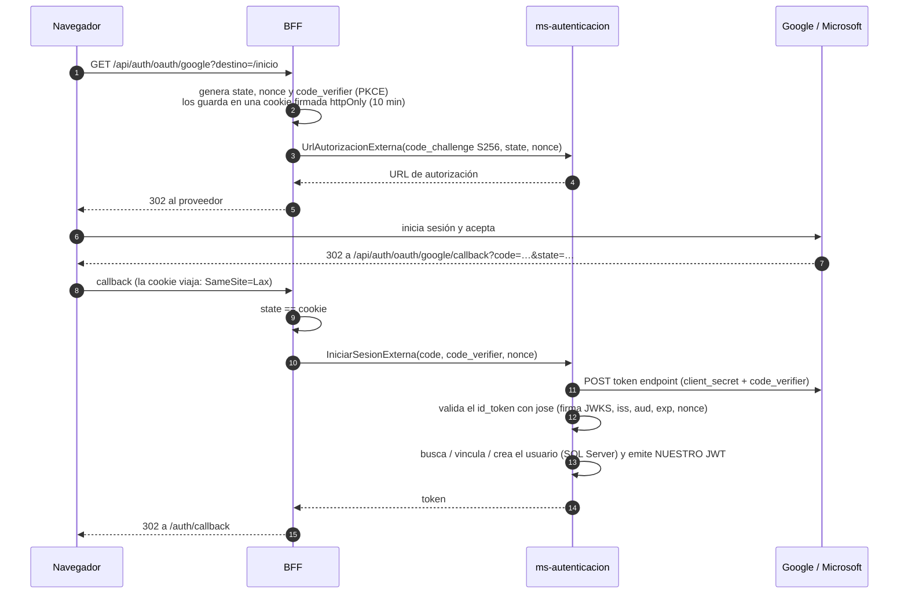

# Cuentas de Google y Microsoft, y Google Drive — guía de configuración

Tres integraciones con la nube, todas opcionales para correr el proyecto en local (sin ellas
los botones de Google/Microsoft aparecen deshabilitados y las imágenes se guardan en disco):

| Integración | Servicio | Variables |
|---|---|---|
| Iniciar sesión con Google | `ms-autenticacion` | `GOOGLE_CLIENT_ID`, `GOOGLE_CLIENT_SECRET` |
| Iniciar sesión con Microsoft | `ms-autenticacion` | `MICROSOFT_CLIENT_ID`, `MICROSOFT_CLIENT_SECRET`, `MICROSOFT_TENANT` |
| Imágenes en Google Drive | `ms-imagenes` | `IMAGENES_ALMACEN=drive`, `DRIVE_AUTENTICACION`, … |

Verificado contra la documentación oficial en noviembre de 2026.

---

## 1. Cómo funciona el inicio de sesión externo

Flujo **OpenID Connect Authorization Code con PKCE**, hecho completamente en el servidor (el
navegador nunca ve un `client_secret` ni un token del proveedor):



Reglas de identidad (por qué están así):

- **Google**: la llave del usuario es el claim `sub` (estable, nunca se reutiliza). Si ya existe
  una cuenta local con el mismo correo y Google dice `email_verified: true`, se vincula sola.
- **Microsoft**: la llave es **(`tid`, `sub`)** — el mismo `sub` en otro tenant es otra persona.
  El claim `email` de Microsoft **no está verificado** (puede ponerlo el administrador de
  cualquier tenant: la familia de fallas conocida como *nOAuth*), así que **nunca** se vincula
  por correo: si ya existe una cuenta local con ese correo, se le pide al usuario entrar con
  su contraseña.
- Una cuenta creada por Google/Microsoft nace **sin ficha de cliente** (sin documento ni fecha
  de nacimiento): la aplicación le pide **completar el perfil** antes de apostar o recargar.

## 2. Google Cloud Console

1. https://console.cloud.google.com → crear (o elegir) un proyecto.
2. *APIs y servicios → Pantalla de consentimiento de OAuth*: tipo **Externo**; nombre de la app,
   correo de soporte; scopes `openid`, `email`, `profile` (son básicos: no requieren verificación).
3. *Credenciales → Crear credenciales → ID de cliente de OAuth* → tipo **Aplicación web**.
4. **URI de redireccionamiento autorizados** (coincidencia exacta):
   - `http://localhost:3003/api/auth/oauth/google/callback` (desarrollo: pasa por el proxy de Vite)
   - en producción: `https://<tu-dominio>/api/auth/oauth/google/callback`
5. Copiar el *ID de cliente* y el *Secreto* a `servicios/ms-autenticacion/.env`:
   ```ini
   GOOGLE_CLIENT_ID=xxxxxxxx.apps.googleusercontent.com
   GOOGLE_CLIENT_SECRET=GOCSPX-xxxxxxxx
   ```

Endpoints que usa el servicio: autorización `https://accounts.google.com/o/oauth2/v2/auth`,
token `https://oauth2.googleapis.com/token`, llaves `https://www.googleapis.com/oauth2/v3/certs`,
emisores válidos `https://accounts.google.com` y `accounts.google.com`.

## 3. Microsoft Entra ID (cuentas Microsoft personales y de trabajo)

1. https://entra.microsoft.com → *Identidad → Aplicaciones → Registros de aplicaciones → Nuevo registro*.
   (Con una cuenta personal, primero crear una suscripción gratuita de Azure: eso crea el
   "Default Directory" donde se registra la app.)
2. **Tipos de cuenta admitidos**:

   | Opción | `MICROSOFT_TENANT` |
   |---|---|
   | Cuentas de cualquier organización **y** cuentas personales de Microsoft | `common` (recomendado) |
   | Solo cuentas personales (Outlook, Hotmail, Xbox) | `consumers` |
   | Solo cuentas de organizaciones | `organizations` |
   | Solo mi organización | el GUID del tenant |

3. **URI de redirección**, plataforma **Web** (no "SPA"):
   `http://localhost:3003/api/auth/oauth/microsoft/callback`
   (Microsoft exige HTTPS salvo para `localhost`.)
4. *Certificados y secretos → Nuevo secreto de cliente*. **Es obligatorio**: una app con
   plataforma Web es un cliente confidencial y sin secreto el token responde `AADSTS7000218`.
   Copiar el **Valor** (no el "Id. del secreto").
5. `.env` de `ms-autenticacion`:
   ```ini
   MICROSOFT_CLIENT_ID=00000000-0000-0000-0000-000000000000   # Id. de aplicación (cliente)
   MICROSOFT_CLIENT_SECRET=xxxxx~xxxxxxxxxxxxxxxxxxxxxxxx
   MICROSOFT_TENANT=common
   ```

Validación del `id_token` con tenant `common` (no se puede fijar un único emisor): el claim
`tid` debe ser un GUID, `iss` debe ser exactamente `https://login.microsoftonline.com/{tid}/v2.0`,
y el emisor declarado por la llave que firmó (`jwk.issuer`, con `{tenantid}` reemplazado) debe
coincidir con `iss`.

## 4. Google Drive para las imágenes (`ms-imagenes`)

**Dato clave (2025):** las *cuentas de servicio* de Google **ya no tienen cuota** en "Mi unidad":
no pueden ser dueñas de archivos. Subir con una cuenta de servicio a una carpeta normal falla
con `storageQuotaExceeded`. Hay dos caminos válidos:

### Opción A — Cuenta personal @gmail.com (OAuth con refresh token) — la de un estudiante

1. En el mismo proyecto de Google Cloud: habilitar **Google Drive API**.
2. Crear (o reutilizar) un ID de cliente OAuth tipo **Aplicación web** y agregar la redirección
   `http://localhost:53682/oauth2callback`.
3. Pantalla de consentimiento: agregar el scope `https://www.googleapis.com/auth/drive.file`
   (no sensible: la app solo ve los archivos que ella misma crea).
4. **Publicar la app ("En producción")**. Si se queda en *Testing*, el refresh token **vence a
   los 7 días** y las imágenes dejan de cargar.
5. Obtener el refresh token una sola vez:
   ```powershell
   cd servicios/ms-imagenes
   $env:DRIVE_OAUTH_CLIENT_ID="..."; $env:DRIVE_OAUTH_CLIENT_SECRET="..."
   node db/obtener-refresh-token.js
   ```
   Abre la URL que imprime, acepta, y copia el `DRIVE_OAUTH_REFRESH_TOKEN` que aparece.
   (Alternativa: OAuth Playground con "Use your own OAuth credentials".)
6. `.env` de `ms-imagenes`:
   ```ini
   IMAGENES_ALMACEN=drive
   DRIVE_AUTENTICACION=oauth
   DRIVE_OAUTH_CLIENT_ID=...
   DRIVE_OAUTH_CLIENT_SECRET=...
   DRIVE_OAUTH_REFRESH_TOKEN=...
   ```
7. `npm run db:setup:imagenes` crea la carpeta raíz **por la API** (con `drive.file`, una
   carpeta creada a mano en la web de Drive no es visible para la app), sube los 16 escudos e
   imprime el id de la carpeta para ponerlo en `DRIVE_CARPETA_RAIZ_ID`.

### Opción B — Google Workspace (unidad compartida + cuenta de servicio)

1. Crear una **cuenta de servicio** y descargar su llave JSON a
   `servicios/ms-imagenes/credenciales/drive.json` (la carpeta está en `.gitignore`).
2. Crear una **unidad compartida** (solo existe en Workspace, no en @gmail.com) y agregar el
   correo de la cuenta de servicio como **Administrador de contenido** (o *Administrador* si se
   quiere borrado permanente).
3. `.env`:
   ```ini
   IMAGENES_ALMACEN=drive
   DRIVE_AUTENTICACION=cuenta_servicio
   GOOGLE_DRIVE_CREDENCIALES=./credenciales/drive.json
   DRIVE_UNIDAD_COMPARTIDA_ID=0AxxxxxxxxxxxxUk9PVA
   ```

### Cómo usa Drive el servicio (resumen)

- Carpeta raíz "GolDorado - Imagenes" con una subcarpeta por entidad (equipo, jugador, estadio,
  torneo, promocion, usuario).
- Cada archivo lleva `appProperties` `{ app, entidad, idEntidad, subidoPor }`: así Drive hace de
  "base de datos" y se consulta con `q` (ver `servicios/ms-imagenes/db/03_consultas.md`).
- Un índice en memoria (entidad + id → imagen) evita consultar Drive en cada carga de la home.
- Descargar un archivo cuesta 200 "unidades de cuota" de la API: por eso hay caché en el
  servicio y el BFF sirve las imágenes con `Cache-Control: immutable`.

### Sin nube (`IMAGENES_ALMACEN=local`)

Guarda los archivos en `servicios/ms-imagenes/storage/` con la misma interfaz. Es el modo por
defecto para desarrollar.

## Fuentes

- https://developers.google.com/identity/openid-connect/openid-connect
- https://developers.google.com/identity/protocols/oauth2/web-server
- https://learn.microsoft.com/en-us/entra/identity-platform/v2-oauth2-auth-code-flow
- https://learn.microsoft.com/en-us/entra/identity-platform/id-token-claims-reference
- https://learn.microsoft.com/en-us/entra/identity-platform/claims-validation
- https://developers.google.com/workspace/drive/api/guides/handle-errors (storageQuotaExceeded)
- https://developers.google.com/workspace/drive/api/guides/properties (appProperties)
- https://developers.google.com/workspace/drive/api/guides/search-files
- https://developers.google.com/identity/protocols/oauth2 (vencimiento de refresh tokens)
