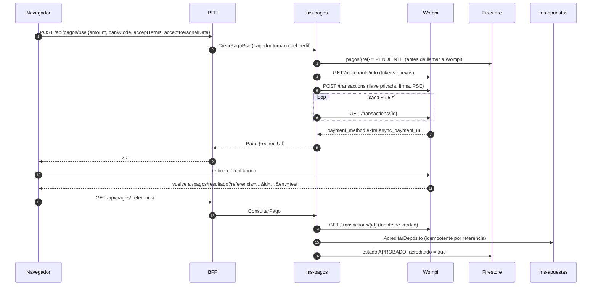

# Pagos con Wompi — guía de integración

`ms-pagos` integra **Wompi** (pasarela de Bancolombia) para que el cliente recargue su saldo.
Hay dos caminos y los dos terminan igual: el saldo se acredita **una sola vez**, en
`ms-apuestas`, cuando Wompi confirma el pago.

| Camino | Qué ve el usuario | Para qué |
|---|---|---|
| **PSE por API** | Elige su banco en *nuestra* pantalla y salta directo al banco | Es el "PSE" del tablero: la integración completa, con nuestra UI |
| **Web Checkout** | Una página alojada por Wompi con todos sus medios (tarjeta, Nequi, PSE, Bancolombia…) | Cualquier otro medio sin tocar datos de tarjeta |

Toda la información de esta guía se verificó contra la documentación oficial y con llamadas
reales al sandbox (noviembre de 2026). Donde la documentación de Wompi está desactualizada o
es incorrecta, se indica.

---

## 1. Llaves y ambientes

En [comercios.wompi.co](https://comercios.wompi.co) → *Desarrolladores*, cada comercio tiene
cuatro valores por ambiente:

| Variable de `ms-pagos` | Prefijo sandbox / producción | Dónde se usa | ¿Secreto? |
|---|---|---|---|
| `WOMPI_LLAVE_PUBLICA` | `pub_test_` / `pub_prod_` | header `x-merchant-public-key`, `Authorization` del listado de bancos, parámetro `public-key` del checkout | No (puede ir al navegador) |
| `WOMPI_LLAVE_PRIVADA` | `prv_test_` / `prv_prod_` | `Authorization: Bearer` para **crear y consultar** transacciones | **Sí**, solo backend |
| `WOMPI_SECRETO_EVENTOS` | `test_events_` / `prod_events_` | calcular el checksum de los webhooks | **Sí**, nunca viaja |
| `WOMPI_SECRETO_INTEGRIDAD` | `test_integrity_` / `prod_integrity_` | calcular la firma de integridad | **Sí**, nunca viaja |

`WOMPI_MODO`:

| Valor | API | Uso |
|---|---|---|
| `sandbox` | `https://sandbox.wompi.co/v1` | desarrollo con llaves `_test_` (no mueve dinero) |
| `produccion` | `https://production.wompi.co/v1` | real |
| `simulado` | — (no llama a Wompi) | desarrollar sin llaves: un banco que aprueba y uno que rechaza |

Las llaves de un ambiente no sirven en el otro (401 *"La llave proporcionada no corresponde a
este ambiente"*).

## 2. Lo que hay que saber antes de programar (hallazgos verificados)

1. **Tokens de aceptación: endpoint nuevo.** Se piden con `GET /v1/merchants/info` y el header
   `x-merchant-public-key`. El endpoint viejo `GET /merchants/{llave}` quedó deprecado
   (fecha de retiro anunciada: 31 de octubre de 2026).
2. **Los tokens de aceptación son de UN solo uso y vencen en 1 hora.** Reutilizar
   `acceptance_token` da 422 *"El token de aceptación ya fue usado"*. Por eso `ms-pagos` pide
   tokens **nuevos para cada transacción** y nunca los cachea.
3. **Hacen falta los dos tokens**: `acceptance_token` (reglamento de usuarios) y
   `accept_personal_auth` (tratamiento de datos personales — Habeas Data). Y el usuario debe
   aceptar **cada contrato con una casilla explícita**: por eso la pantalla de recarga muestra
   dos casillas con los enlaces (`permalink`) que devuelve Wompi, y el servicio rechaza el
   pago si alguna no viene marcada.
4. **Crear y consultar transacciones: llave privada.** `GET /v1/transactions/{id}` con la llave
   pública o sin autenticación está documentado como 404 (el sandbox aún respondía, pero no se
   puede depender de eso). El frontend **ya no puede** consultar transacciones: todo pasa por el BFF.
5. **El webhook debe responder exactamente HTTP 200.** 201 o 204 cuentan como fallo y Wompi
   reintenta (+30 min, +3 h, +24 h).
6. **El ejemplo oficial del checksum de eventos está mal.** La documentación muestra
   `3476DDA5…`, que no es el SHA-256 de la cadena que ella misma publica. El valor correcto
   (comprobado con Node, `sha256sum` y Python) está en la sección 6 y es el que usan las pruebas.
7. **Referencias:** máximo 255 caracteres; la de una transacción APPROVED no se puede
   reutilizar; con el *reintento de pago* del checkout pueden existir **dos transacciones con
   la misma referencia** (por ejemplo una DECLINED y otra APPROVED).
8. **Montos:** `amount_in_cents` entero terminado en `00`; mínimo **$1.500** (`150000`
   centavos). `ms-pagos` usa por defecto mínimo $5.000 y máximo $3.000.000 (configurable).

## 3. Firma de integridad

```
signature = SHA256_hex( referencia + monto_en_centavos + moneda [+ fecha_expiracion] + secreto_integridad )
```

- Va como `"signature"` en `POST /transactions` y como `signature:integrity` en el Web Checkout.
- Se calcula **siempre en el servidor** (`servicios/ms-pagos/src/wompi/firmas.js`).
- Vector oficial (lo verifica la prueba unitaria):
  `sk8-438k4-xmxm392-sn2m2490000COPprod_integrity_Z5mMke9x0k8gpErbDqwrJXMqsI6SFli6`
  → `37c8407747e595535433ef8f6a811d853cd943046624a0ec04662b17bbf33bf5`

## 4. Flujo PSE por API



Cuerpo de `POST /v1/transactions` (lo arma `ms-pagos`):

```json
{
  "acceptance_token": "<presigned_acceptance.acceptance_token>",
  "accept_personal_auth": "<presigned_personal_data_auth.acceptance_token>",
  "amount_in_cents": 5000000,
  "currency": "COP",
  "signature": "<firma de integridad>",
  "customer_email": "demo@goldorado.co",
  "reference": "GD-1-1762700000000-a1b2",
  "redirect_url": "http://localhost:3003/pagos/resultado?referencia=GD-1-1762700000000-a1b2",
  "ip": "190.x.x.x",
  "customer_data": { "full_name": "Camilo Rojas", "phone_number": "573001234567" },
  "payment_method": {
    "type": "PSE",
    "user_type": 0,
    "user_legal_id_type": "CC",
    "user_legal_id": "1012345678",
    "financial_institution_code": "1",
    "payment_description": "Recarga GolDorado"
  }
}
```

Reglas: `user_type` 0 = persona natural, 1 = jurídica; `user_legal_id_type` uno de
`RC, TI, CC, TE, CE, NIT, PP, DNI, PPT, PA`; `payment_description` **≤ 30 caracteres** (la
documentación se contradice entre 30 y 64); teléfono con indicativo `57` y sin `+`.
`async_payment_url` **no** viene en la respuesta de creación: hay que consultar la transacción
hasta que aparezca.

**Regreso:** Wompi añade `id` y `env` a la `redirect_url` con `URLSearchParams.append`, es
decir, respeta el query que ya tenga. Por eso `ms-pagos` pone `?referencia=` en la URL de
retorno y la página del frontend sabe qué pago consultar. **La redirección es solo
informativa**: el estado real se lee de la API con la llave privada o de un webhook firmado.

## 5. Web Checkout

`ms-pagos` arma `https://checkout.wompi.co/p/?…` con:

| Parámetro | Valor |
|---|---|
| `public-key` | `WOMPI_LLAVE_PUBLICA` |
| `currency` | `COP` |
| `amount-in-cents` | monto × 100 |
| `reference` | la referencia del pago |
| `signature:integrity` | firma de la sección 3 |
| `redirect-url` | `…/pagos/resultado?referencia=<ref>` |
| `customer-data:email`, `customer-data:full-name` | del perfil |

El id de la transacción solo se conoce al volver (`?id=`) o por el webhook; mientras tanto la
conciliación consulta `GET /v1/transactions?reference=<ref>` (llave privada).

## 6. Webhook (eventos)

- URL a configurar en el panel de Wompi (una por ambiente): `https://<tu-dominio>/api/pagos/webhook`.
- En local hace falta un túnel HTTPS hacia el BFF, por ejemplo:
  `cloudflared tunnel --url http://localhost:3000` o `ngrok http 3000`, y registrar
  `https://<subdominio-del-tunel>/api/pagos/webhook`.
- Cuerpo:
  ```json
  {"event":"transaction.updated",
   "data":{"transaction":{"id":"1234-1610641025-49201","amount_in_cents":4490000,"reference":"MZQ3X2DE2SMX","status":"APPROVED", "...":"..."}},
   "environment":"prod",
   "signature":{"properties":["transaction.id","transaction.status","transaction.amount_in_cents"],"checksum":"…"},
   "timestamp":1530291411, "sent_at":"2018-07-20T16:45:05.000Z"}
  ```
- **Checksum** = SHA-256 hex de: los valores de cada ruta de `signature.properties`
  (resueltas dentro de `data`, en ese orden) + `timestamp` + secreto de eventos. Llega en el
  header `X-Event-Checksum` y en `signature.checksum`; la comparación ignora mayúsculas. **No
  se deben fijar las `properties` en el código**: Wompi puede cambiarlas.
- Vector de prueba correcto:
  `1234-1610641025-49201APPROVED44900001530291411prod_events_OcHnIzeBl5socpwByQ4hA52Em3USQ93Z`
  → `5a18ec5e8fdb7df463e9f94774cba8f583ba21bd04a09ceff2ea68a4bc0aefbe`
- `ms-pagos`: firma inválida → 401 (y evento de seguridad CRÍTICO); `environment` de otro
  ambiente → se ignora con 200; luego **vuelve a leer la transacción con la llave privada**
  (fuente de verdad) y aplica el estado; error transitorio → 500 para que Wompi reintente.

## 7. Estados

| Wompi | GolDorado | Efecto |
|---|---|---|
| `PENDING` | `PENDIENTE` | nada todavía |
| `APPROVED` | `APROBADO` | acreditar saldo (una vez) |
| `DECLINED` | `RECHAZADO` | nada |
| `VOIDED` | `ANULADO` | solo tarjetas |
| `ERROR` | `ERROR` | nada |

Antes de acreditar, `ms-pagos` comprueba que la transacción de Wompi coincide con **su**
registro: misma referencia, `amount_in_cents` idéntico y moneda `COP`. Si no coincide, no
acredita y lo reporta como evento de seguridad. Una segunda transacción APPROVED con la misma
referencia (reintento del checkout) no se acredita dos veces: queda marcada para devolución manual.

## 8. Datos de prueba del sandbox

| Medio | Aprobada | Rechazada | Error |
|---|---|---|---|
| PSE (`financial_institution_code`) | `1` "Banco que aprueba" | `2` "Banco que declina" | `3` |
| Tarjeta | `4242 4242 4242 4242` | `4111 1111 1111 1111` | cualquier otra |
| Nequi | `3991111111` | `3992222222` | cualquier otro |

En sandbox el banco "1" pasa a APPROVED unos 2 segundos después de crear la transacción, sin
que nadie visite la URL del banco. En producción queda PENDING hasta que el usuario termina en
su banco.

## 9. Probar sin llaves (`WOMPI_MODO=simulado`)

El servicio ofrece "Banco que aprueba (simulado)" y "Banco que rechaza (simulado)", devuelve
una URL de retorno directa al frontend y, al consultar, resuelve el pago con **el mismo
código** de transición y acreditación que el modo real. Sirve para la demostración en clase
cuando no hay conexión o llaves.

## Fuentes

- https://docs.wompi.co/docs/colombia/ambientes-y-llaves/
- https://docs.wompi.co/docs/colombia/tokens-de-aceptacion/
- https://docs.wompi.co/docs/colombia/widget-checkout-web/
- https://docs.wompi.co/docs/colombia/metodos-de-pago/#pse
- https://docs.wompi.co/docs/colombia/datos-de-prueba-en-sandbox/
- https://docs.wompi.co/docs/colombia/eventos/
- https://docs.wompi.co/docs/colombia/seguimiento-de-transacciones/
- https://docs.wompi.co/docs/colombia/reintento-de-pago/
- https://soporte.wompi.co (montos mínimos y máximos por medio)
